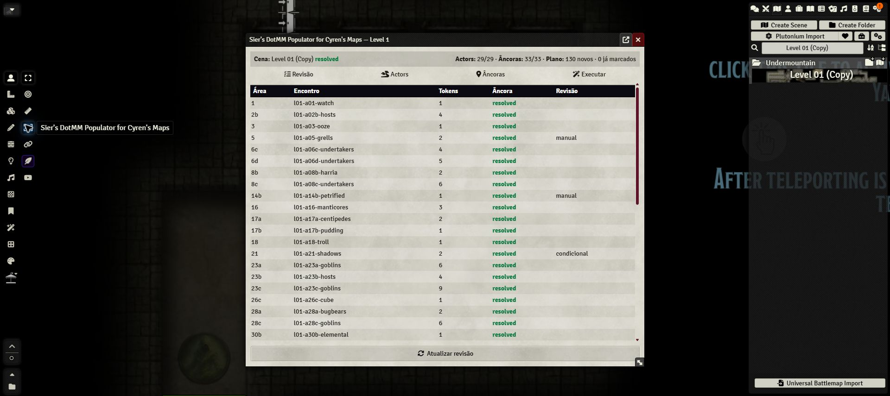
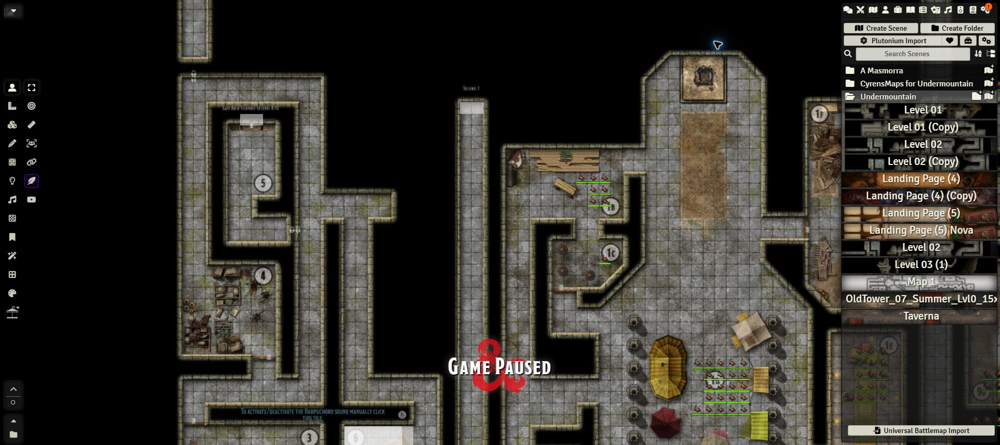

# Sier's DotMM Populator for Cyren's Maps

A safety-first Foundry VTT module for preparing the static Level 1 and Level 2 encounters from *Dungeon of the Mad Mage* on maps supplied by **CyrensMaps for Undermountain**.

It reviews Scene compatibility, resolves existing World Actors, previews deterministic token placement, and creates only explicitly flagged Tokens. It never bundles maps, artwork, adventure prose, journals, or creature stat blocks.

> **Current scope:** Levels 1–2. Foundry VTT 12.331 and D&D5e 3.1.2–3.2.1.





## Features

- Selects Level 1 or Level 2 and detects the matching Cyren Scene by source metadata, name, geometry, and grid.
- Resolves World Actors without silently choosing ambiguous matches.
- Prefers newer equivalent creature sources in the order XMM, MPMM, then MM.
- Opens Plutonium's creature importer when Plutonium is available.
- Previews placements without saving documents.
- Creates, reconciles, rebuilds, and removes only module-owned Tokens.
- Uses deterministic instance keys, so repeated runs are idempotent.
- Verifies that Walls, Lights, Tiles, Notes, Sounds, Drawings, and Regions remain unchanged.
- Blocks persistence while an Actor, Scene, or area anchor is unresolved.

## Install

### Foundry manifest

In **Setup → Add-on Modules → Install Module**, paste:

```text
https://raw.githubusercontent.com/sierrific/sier-s-dotmm-populator-for-cyren-s-maps/main/cyren-dotmm-populator/module.json
```

The repository and release must be publicly accessible for Foundry's manifest installer to work without GitHub authentication.

### Release ZIP

Download `cyren-dotmm-populator-0.2.1.zip` from the latest release and extract it into:

```text
<FoundryUserData>/Data/modules/cyren-dotmm-populator
```

Windows and Linux helper scripts are provided in [`installer/`](installer/). Each release includes the ZIP, both helper installers, and a SHA-256 checksum for the package. Full instructions are in [Installation](docs/INSTALLATION.md).

## Requirements

| Component | Supported version | Required |
|---|---:|---:|
| Foundry Virtual Tabletop | 12.331 | Yes |
| D&D5e system | 3.1.2–3.2.1 | Yes |
| CyrensMaps for Undermountain | 1.0.0 | Yes |
| Plutonium | 2.1.3 | No, but recommended |

Actors are not distributed by this project. Import or create the required Actors in the World before populating the Scene.

## Quick start

1. Install and enable CyrensMaps for Undermountain, D&D5e, and this module.
2. Open the Level 1 or Level 2 Scene. If using a copy, right-click it in the Scenes directory and choose **View Scene**.
3. Open **Sier's DotMM Populator for Cyren's Maps** from the Token controls or Module Settings.
4. Choose the desired level, select **Refresh review**, and resolve every Actor or anchor warning.
5. Use **Open Plutonium** for missing creatures, preferring XMM, then MPMM, then MM when equivalent entries exist.
6. Run **Preview without saving** and inspect the Scene.
7. Select **Create missing** only after the review is clear.

See the [User Guide](docs/USER-GUIDE.md) for recovery, reconciliation, and area-level rebuilds.

## Safety model

Every created Token receives a `flags.cyren-dotmm-populator` ownership marker and deterministic key. Removal and rebuild operations query those flags and cannot target unmarked Tokens. Persistent operations are GM-only and destructive actions require confirmation.

The full design is documented in [Technical Notes](docs/TECHNICAL.md). Validation results are summarized in [Validation](docs/VALIDATION.md).

## Development

```bash
npm install
npm run validate
npm test
npm run build
npm run audit
```

The build command creates a reproducible Foundry-ready ZIP and SHA-256 checksum in `dist/`. Release tags named `v<version>` are validated, packaged, audited, and published by GitHub Actions.

See [Development and releases](docs/DEVELOPMENT.md).

## Documentation

- [Installation](docs/INSTALLATION.md)
- [User Guide](docs/USER-GUIDE.md)
- [Technical Notes](docs/TECHNICAL.md)
- [Validation](docs/VALIDATION.md)
- [Level 2 notes](docs/LEVEL-02.md)
- [Development and releases](docs/DEVELOPMENT.md)
- [Changelog](CHANGELOG.md)
- [Security policy](SECURITY.md)

## Legal

This project distributes only original module code and minimal placement metadata. You must supply your own licensed Foundry VTT installation, game system, maps, adventure material, and creature data.

This is an independent fan-made utility. It is not affiliated with or endorsed by Foundry Gaming LLC, Wizards of the Coast, or the creators of CyrensMaps.
